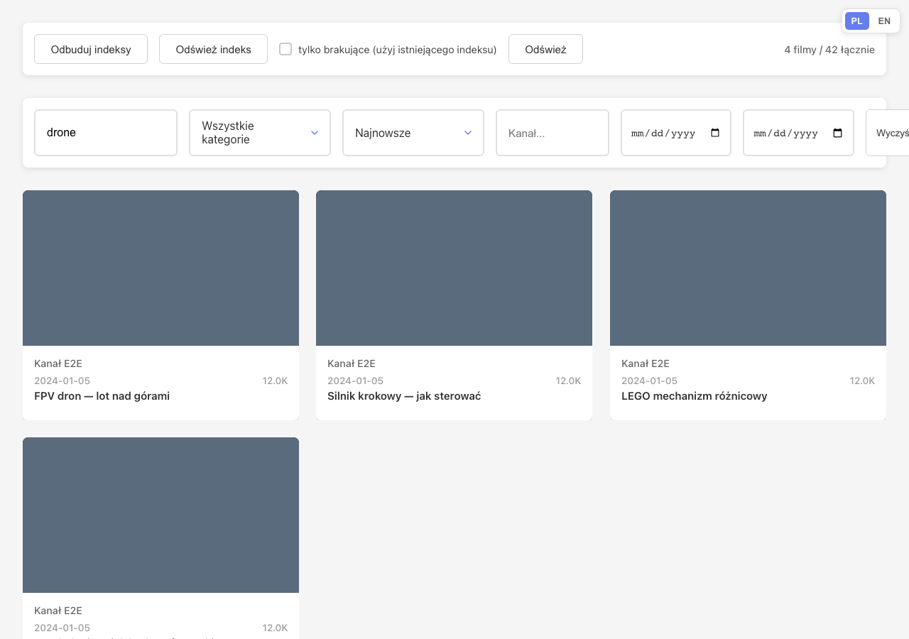
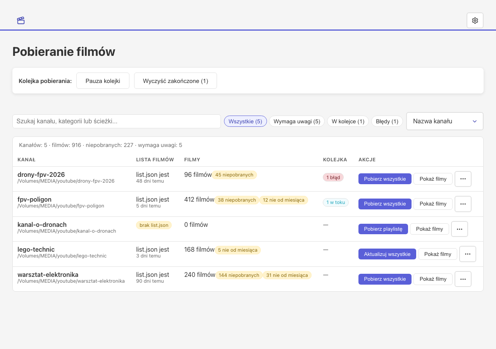
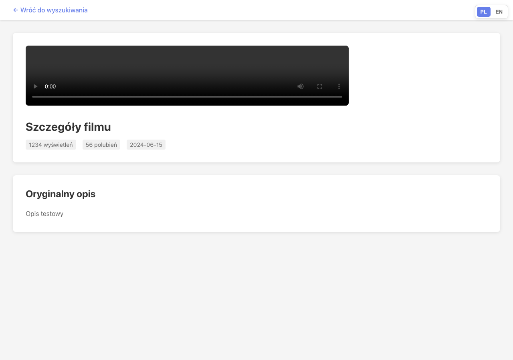

# Video Search App

Aplikacja webowa do wyszukiwania i oglądania filmów z YouTube pobranych
przez yt-dlp. Tytuły, opisy, komentarze i transkrypty napisów trafiają do
indeksu Elasticsearch; odtwarzacz w przeglądarce obsługuje napisy w wielu
językach; serwerowa kolejka steruje yt-dlp per kanał. Rozszerzenie Chrome
dodaje filmy do kolejki wprost z YouTube.

- Wyszukiwanie działa bez polskich znaków: `srodek` znajduje `środek`
- Odtwarzacz w przeglądarce z pobranymi napisami
- Konfiguracja pobierania per kanał i kolejka, która przeżywa zamknięcie karty
- Interfejs po polsku i angielsku z ciemnym motywem

## Zrzuty ekranu

<p align="center">
  
  
  
</p>

> Dokumentacja angielska: [../README.md](../README.md)

## Funkcjonalności

- **Wyszukiwanie filmów** - pełnotekstowe po tytule, opisie, transkrypcie
  napisów i komentarzach ze składaniem diakrytyków; sortowanie po trafności,
  dacie, wyświetleniach lub polubieniach, wyniki stronicowane
- **Odtwarzacz wideo** - odtwarzanie w HTML5 z napisami z pobranych plików
  `.vtt`
- **Szczegóły** - tytuł, opis, statystyki, kanał i drzewo komentarzy
  z zagnieżdżonymi odpowiedziami
- **Filtry** - kategoria (per kanał, z `config.json`) i kanał; cały stan
  wyszukiwania siedzi w URL, więc linki można udostępniać
- **Odświeżanie cache** - reindeks z dysku bez przestoju (przełączanie
  aliasów), z trybem „tylko brakujące" dla świeżo podłączonych dysków
- **Kolejka pobierania** - zadania download i update, współbieżność per
  folder, pauza, anulowanie, postęp na żywo
- **Rozszerzenie Chrome** - dodawanie filmów z YouTube z postępem SSE
  i licznikiem na ikonie ([chrome-extension/README.md](../chrome-extension/README.md))
- **Responsywność + ciemny motyw** - od telefonu po desktop, motyw
  jasny/ciemny/systemowy
- **Interfejs po polsku i angielsku**

## Szybki start

1. Zainstaluj zależności całego workspace:

   ```bash
   pnpm install   # zamrożona wersja jak w CI: pnpm run install:ci
   ```

2. Uruchom Elasticsearch (tylko loopback; bez hasła):

   ```bash
   docker run -d --name videodeck-elasticsearch --restart unless-stopped \
     --log-driver json-file --log-opt max-size=10m --log-opt max-file=5 \
     -p 127.0.0.1:9200:9200 \
     -v videodeck-es-data:/usr/share/elasticsearch/data \
     -e discovery.type=single-node \
     -e xpack.security.enabled=false \
     -e xpack.security.enrollment.enabled=false \
     -e ES_JAVA_OPTS="-Xms1g -Xmx1g" \
     --health-cmd 'curl -fs "http://localhost:9200/_cluster/health?wait_for_status=yellow&timeout=5s" >/dev/null || exit 1' \
     --health-interval 10s --health-timeout 10s --health-retries 30 --health-start-period 60s \
     docker.elastic.co/elasticsearch/elasticsearch:9.5.1
   ```

   Uruchom ją dokładnie tak, jak jest zapisana. Nazwa, wolumen i polityka
   restartu sprawiają, że węzeł przeżywa restart Dockera bez reindeksowania,
   a flagi health pokazują `(healthy)` w `docker ps`, gdy klaster przyjmuje
   pracę. Pierwszy start trwa około pół minuty. Opis każdej flagi jest
   w [docs/INSTALL.md](INSTALL.md), razem z wariantem Homebrew i instalacją
   ręczną.

3. Utwórz `server/.env`:

   ```
   VIDEOS_FOLDER_PATH=/ścieżka/do/folderu/z/filmami
   ELASTICSEARCH_URL=http://localhost:9200
   ```

   Kilka folderów? Oddziel je `;` albo `,`. Wzorce dla dysków wymiennych
   i wszystkie opcjonalne zmienne: [docs/INSTALL.md](INSTALL.md).

4. Uruchom aplikację:

   ```bash
   pnpm run dev
   ```

   Serwer na `http://localhost:3001`, interfejs na `http://localhost:3000`.

5. Zaindeksuj filmy raz. Na liście filmów otwórz menu zębatki w górnym
   pasku i wybierz **„Odśwież indeks"** (en: "Refresh index") albo wywołaj
   `POST /api/videos/refreshCache`. Duże biblioteki chwilę trwają; postęp
   widać w toaście.

## Wymagania

- Node.js 24, w wersji 24.22.3 lub nowszej (corepack dostarcza pnpm 12.4.2, przypięty w `packageManager`)
- Elasticsearch 8.x lub 9.x (lokalnie lub zdalnie)
- Chrome 102+ (tylko dla rozszerzenia Chrome, zob. [chrome-extension/README.md](../chrome-extension/README.md))

## Konfiguracja

Najważniejsze zmienne:

| Zmienna               | Co robi                                                                          |
| --------------------- | -------------------------------------------------------------------------------- |
| `VIDEOS_FOLDER_PATH`  | jeden lub więcej folderów do skanowania (oddziel `;` lub `,`)                    |
| `ELASTICSEARCH_URL`   | adres Elasticsearch                                                              |
| `API_TOKEN`           | token bearer chroniący `/api`; ustaw przed wystawieniem serwera poza loopback    |
| `OPENAI_API_KEY`      | włącza streszczenia AI (`GET /api/videos/:id/summary`)                           |
| `DEEPSEEK_API_KEY`    | liczy te streszczenia na DeepSeeku; `SUMMARY_PROVIDER` przypina providera        |

Streszczenia włącza dowolny z tych kluczy, a dodanie klucza DeepSeeka jest
przełączeniem: gdy są oba, odpowiada DeepSeek, chyba że `SUMMARY_PROVIDER=openai`
mówi inaczej.

Pełna lista (współbieżność, limity żądań, CORS, allowlista hostów, originy
rozszerzenia i więcej): [docs/INSTALL.md](INSTALL.md). Konsekwencje
bezpieczeństwa opisuje sekcja Bezpieczeństwo poniżej.

## Dokumentacja

| Dokument                                         | Zawiera                                                              |
| ------------------------------------------------ | -------------------------------------------------------------------- |
| [docs/INSTALL.md](INSTALL.md)                    | opcje instalacji, wszystkie zmienne środowiskowe, buildy produkcyjne |
| [docs/DEPLOYMENT.md](DEPLOYMENT.md)              | wdrożenie Docker, aktualizacje, kopie zapasowe                       |
| [docs/API.md](API.md)                            | endpointy HTTP, model indeksowania, formaty na dysku, `config.json`  |
| [docs/DEVELOPMENT.md](DEVELOPMENT.md)            | linting, testy, pokrycie, typowanie, struktura projektu               |
| [docs/architecture/](architecture/)              | typowane diagramy architektury runtime                                |
| [DESIGN.md](../DESIGN.md)                        | kontrakt designu UI (tokeny, komponenty, dostępność)                 |
| [../README.md](../README.md)                     | ten plik po angielsku                                                |
| [CONTRIBUTING.md](../CONTRIBUTING.md)            | workflow, bramki jakości, konwencje                                   |
| [SECURITY.md](../SECURITY.md)                    | zgłaszanie podatności i zakres                                        |
| [CHANGELOG.md](../CHANGELOG.md), [RELEASING.md](../RELEASING.md) | co się zmieniło, jak robimy wydania          |
| [chrome-extension/README.md](../chrome-extension/README.md) | rozszerzenie Chrome                                      |

Część dokumentów (API, DEVELOPMENT, DEPLOYMENT, architektura) jest
prowadzona po angielsku.

## Rozwój

```bash
pnpm run dev          # serwer :3001 + klient :3000
pnpm run test         # testy jednostkowe: serwer, klient i rozszerzenie (vitest)
pnpm run test:e2e     # Playwright z zamokowanym API (przy pierwszym uruchomieniu i po każdej aktualizacji Playwrighta: cd client && pnpm exec playwright install chromium)
```

Reguły lintu, macierz testów, ratchet pokrycia i ścisłe flagi TypeScript:
[docs/DEVELOPMENT.md](DEVELOPMENT.md). Workflow branch/PR/squash i pełna
bramka weryfikacji: [CONTRIBUTING.md](../CONTRIBUTING.md).

## Architektura

Architektura runtime jest zapisana jako typowany JSON w
[docs/architecture/](architecture/) i kompilowana przez vendorowany CLI
archify (MIT) do samodzielnej interaktywnej mapy:
[architecture/videodeck.architecture.html](architecture/videodeck.architecture.html).
`pnpm run test:scripts` waliduje każdy diagram i sprawdza, czy zatwierdzony
HTML zgadza się ze świeżym renderem, więc mapa nie może się rozjechać ze
źródłem.

## Internacjonalizacja (polski / angielski)

- **Klient** (`client/src/i18n/`): react-i18next z katalogami `locales/pl.json`
  i `en.json` — wszystkie stringi UI (strony, komponenty, tosty, postęp
  reindeksu, statusy zadań) idą przez `t()` z typowanymi kluczami (literówka
  w kluczu to błąd TypeScript). Polski jest językiem domyślnym i zapasowym;
  przełącznik PL/EN w prawym górnym rogu zapisuje wybór w localStorage.
  Liczba mnoga korzysta z reguł i18next (pl: 1 film / 2 filmy / 5 filmów).
- **Rozszerzenie Chrome** (`chrome-extension/_locales/{pl,en}/messages.json`):
  natywne `chrome.i18n` — `default_locale: "pl"` w manifeście,
  `chrome.i18n.getMessage` w kodzie, a statyczny HTML jest tłumaczony przez
  `[data-i18n]` (`src/lib/i18n.ts`). Język rozszerzenia idzie za językiem
  przeglądarki (fallback: polski).
- **Serwer**: komunikaty API pozostają po angielsku (stabilne dla logów i
  testów); klient dodaje własne, przetłumaczone prefiksy błędów.

Nowy klucz dodaje się w `pl.json`, `en.json` (opcjonalnie w `messages.json`
rozszerzenia); klucze klienta są sprawdzane typami, więc niespójność wyjdzie
w typechecku. Testy klienta działają przy domyślnym polskim; E2E sprawdza
przełączanie języka w obie strony.

## Bezpieczeństwo

Serwer słucha domyślnie tylko na `127.0.0.1`, a CORS przepuszcza wyłącznie
lokalnego klienta deweloperskiego (`localhost`/`127.0.0.1` na portach 3000,
4173 i 5173), rozszerzenia Chrome i originy wpisane w `CORS_ORIGINS`. Bez
`API_TOKEN` API jest otwarte dla lokalnych procesów.

Żądanie przeglądarki oznaczone `Sec-Fetch-Site: cross-site` dostaje 403,
z tokenem czy bez. Przeglądarka wysyła ten znacznik tylko do adresów HTTPS
i loopback, więc na adresie w sieci lokalnej, takim jak
`http://nas.local:3000`, serwer czyta zamiast niego `Origin`. Zapis
z przeglądarki przechodzi tam tylko z adresu samego UI, z hosta
z `ALLOWED_HOSTS` (na dowolnym porcie) albo z zaufanego originu: portów
klienta deweloperskiego podanych wyżej (na komputerze oglądającego może je
zająć dowolna lokalna aplikacja), rozszerzenia Chrome (tylko id
z `EXTENSION_ORIGINS`, gdy jest ustawione) i `CORS_ORIGINS`. Strona z każdej
innej witryny nie wywoła reindeksu ani nie dopisze zadań do kolejki, więc
wpisuj tam tylko to, co sam uruchamiasz. Link albo obrazek nie wysyła
`Origin` wcale, a jego GET trafia do sprawdzenia tokenu tak jak żądanie
curl. Strona nie odczyta odpowiedzi, ale w tej wersji GET streszczenia
wciąż generuje streszczenie, którego nie ma jeszcze w cache, a dostawca
nalicza za nie opłatę.

Dodatkowe zabezpieczenia:

- **Allowlista Host (DNS rebinding)** — serwer przyjmuje tylko nagłówek
  `Host` z loopback (`localhost`, `127.0.0.1`, `[::1]`) lub z `ALLOWED_HOSTS`.
  Domena atakującego, która rozwiązuje się na 127.0.0.1, wysyła własny
  `Host` i dostaje 403, zanim trafi do API.
- **SSRF w URL wideo** — `POST /api/folder/queue` i `/api/folder/download-video`
  przyjmują wyłącznie adresy YouTube (rozpoznane przez `shared/youtube.ts`);
  każdy inny URL (także `file://` czy adresy IP) jest odrzucany, a do yt-dlp
  trafia zawsze kanoniczny `https://www.youtube.com/watch?v=<id>`. Adres
  kanału z `config.json` przechodzi tę samą kontrolę hosta przy zapisie
  i jeszcze raz przed pobraniem listy, a yt-dlp dostaje go odbudowanego
  z hosta i ścieżki.
- **Allowlista argumentów yt-dlp**: `extraArgs` w `config.json` przyjmuje
  tylko dokładne nazwy flag z `ALLOWED_EXTRA_ARGS`
  (`server/src/services/folderConfig.ts`), każdą ze sprawdzoną wartością.
  Nic innego nie przejdzie, więc do yt-dlp nie trafią ani `--exec`, ani
  flagi ciasteczek i poświadczeń, ani `--alias`, sklejone krótkie opcje czy
  skrócone długie formy (RCE, kradzież ciasteczek, wyciek poświadczeń).
  `PUT /api/folder/config` odpowiada 400 i wymienia dozwolone flagi,
  z ręcznie edytowanego pliku taki wpis wypada razem ze swoją wartością,
  a budowanie argumentów sprawdza listę jeszcze raz, zanim wystartuje yt-dlp.
  Każde pobieranie, aktualizacja, naprawa i pobranie listy kanału dostaje
  `--ignore-config`, więc `yt-dlp.conf` w folderze kanału niczego nie dodaje.
- **Brak otwartego API na interfejsie sieciowym** — serwer nie wystartuje,
  gdy `HOST` nie jest adresem loopback i nie ustawiono ani `API_TOKEN`, ani
  `REQUIRE_API_TOKEN=true`. Wystawienie API do sieci wymaga tokenu, a nie
  przeoczonej zmiennej.
- **Dokładne ID rozszerzenia w CORS** — domyślnie (tryb dev) CORS dopuszcza
  każde `chrome-extension://…`, bo rozszerzenia developerskie dostają nowe ID
  przy każdym załadowaniu. Ustaw `EXTENSION_ORIGINS` z dokładnym ID
  (widoczne na `chrome://extensions`), aby API wywoływało tylko Twoje
  rozszerzenie. Aktualizuj tę listę: przez zwykłe HTTP serwer odrzuca
  rozszerzenie, którego ID na niej nie ma.

Dla zdalnego dostępu ustaw `API_TOKEN` (i ewentualnie `HOST=0.0.0.0` +
`ALLOWED_HOSTS`): każdy request na `/api` musi wtedy nieść
`Authorization: Bearer <token>`. `CORS_ORIGINS` służy stronie na innym
porcie lub subdomenie tej samej witryny, która woła API bezpośrednio;
żądanie oznaczone przez przeglądarkę jako cross-site dostaje 403 nawet
z originem z listy. Przez zwykłe HTTP host, którego używa przeglądarka,
musi być loopbackiem albo stać w `ALLOWED_HOSTS`, jakiekolwiek proxy stoi
przed serwerem: `X-Forwarded-Host` liczy się tylko dla takiej nazwy.
Rozszerzenie Chrome ma pole „Token API" w
opcjach; `/health` pozostaje publiczne do testów połączenia.

Zgłaszanie podatności i zakres: [SECURITY.md](../SECURITY.md).

## Licencja

MIT. Zob. [LICENSE](../LICENSE).

## Współpraca

Błędy, pomysły i pull requesty mile widziane. Zacznij od
[CONTRIBUTING.md](../CONTRIBUTING.md) i
[CODE_OF_CONDUCT.md](../CODE_OF_CONDUCT.md); mapa architektury:
[docs/architecture/](architecture/).
